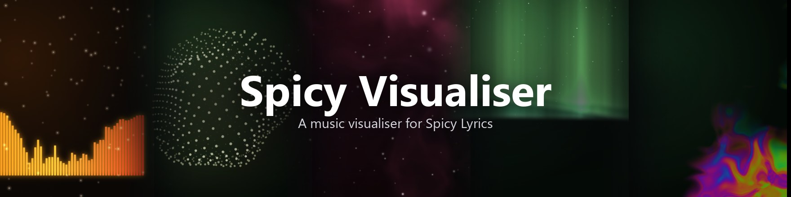
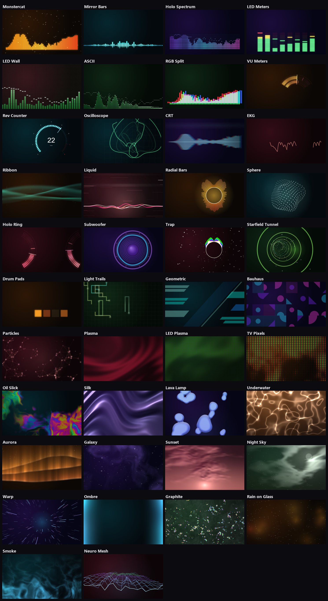
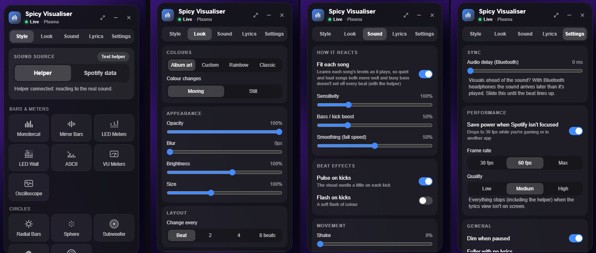
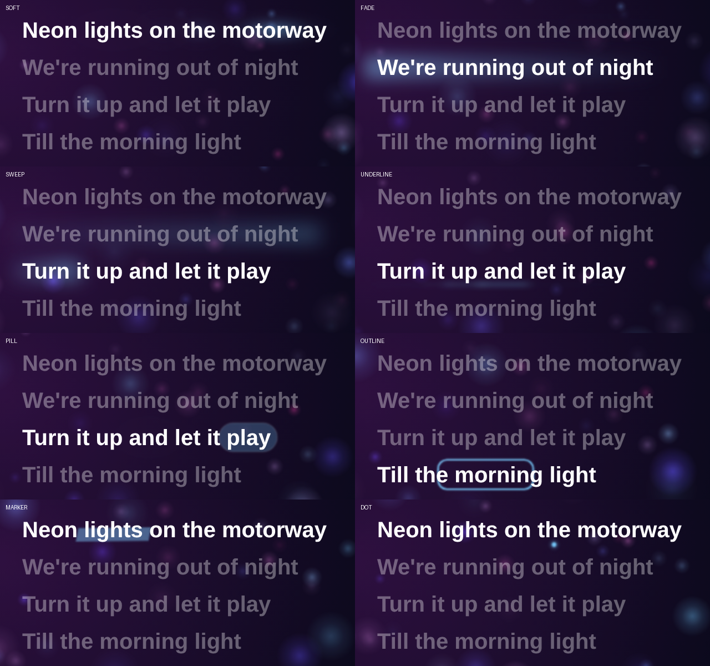

<div align="center">

# Spicy Visualiser (WIP)

**A Spicetify extension that adds a music visualiser to Spicy Lyrics.**

19 styles that move with the music, take their colours from the album cover and sit right behind the lyrics.

> [!IMPORTANT]
> **Needs the Spicy Visualiser helper (Windows).** Spotify doesn't let add-ons hear the music, so a small helper does the listening. It starts with Windows in the background and only listens while the visualiser is on screen. Don't want it? Choose **Spotify data** under **More → Sound source** instead. After installing from the Marketplace, click **Install helper** in the visualiser, or [download the helper](https://github.com/siamct/spicy-visualiser/raw/main/setup/SpicyVisualiserHelper.zip).

[](https://spicetify.app)
[](https://github.com/Spikerko/spicy-lyrics)
[](https://github.com/siamct/spicy-visualiser)
[](LICENSE)

[Styles](docs/STYLES.md) · [Install](#install) · [Settings](#settings) · [How it hears the music](#how-it-hears-the-music)



</div>

---

## Highlights

- **19 styles:** bars, retro and LED spectrums, circles and a subwoofer, beat-locked motion, poster shapes, fluids, particles and 3D landscapes.
- **Album colours:** every song gets its own palette from its cover, shifting on the beat or holding still, as you like. Or pick your own, rainbow, or each style's classic look.
- **Fully customisable:** opacity, size, blur, brightness, bar count, position, sensitivity, bass boost, speed, shake and more. Each style remembers its own settings.
- **Hears the real music:** a small helper listens to Spotify's audio (64 bands, kicks and snares). It only listens while the visualiser is on screen.
- **Lyric highlight:** an optional glow behind the word or line being sung.
- **Every Spicy view:** normal page, fullscreen, cinema and the popout window.
- **Light on your PC:** stops when the lyrics aren't on screen and drops to 30 fps when Spotify isn't focused.

<details>
<summary><b>See all 19 styles</b></summary>

<br>



Each one has its own screenshot and short talk-through in the **[styles guide](docs/STYLES.md)**.

</details>

---

## Install

You need Spotify desktop with [Spicetify](https://spicetify.app) and the **Spicy Lyrics** extension.

### Marketplace + helper (recommended)

1. In Spotify, open **Marketplace** → **Extensions**, search **Spicy Visualiser** and click **Install**.
2. Open Spicy Lyrics. The visualiser asks to install its helper: click **Install helper**. (Or [download the helper](https://github.com/siamct/spicy-visualiser/raw/main/setup/SpicyVisualiserHelper.zip) yourself.)
3. Open **SpicyVisualiserHelper.zip** from your downloads, click **Extract all**, then double-click **Install helper.bat** in the extracted folder. If Windows says it protected your PC (the file isn't signed), click **More info** → **Run anyway**. The visualiser goes **Live** by itself. You can delete the folder afterwards.

**The helper isn't intrusive.** It starts with Windows in the background (Spotify doesn't let add-ons start programs, so it can't be started from Spotify). It sleeps (no listening, next to no CPU) while the visualiser isn't on screen. It installs for your Windows user only (no admin), brings its own copy of Node.js, only listens to Spotify, and nothing leaves your PC. Remove it any time in **Settings → Apps**.

**Sound source** (under **More**): **Helper** reacts to the real sound. **Spotify data** works without the helper, following Spotify's own data for each song; it's an estimate, so it's less accurate.

### Full install from this repo (Windows)

1. Click the green **Code** button at the top of this page → **Download ZIP**, then unzip it.
2. Double-click **`Install Spicy Visualiser.bat`**. If Windows warns you, click **More info** → **Run anyway**.
3. Wait for **Done!**. Spotify restarts by itself.

**Update:** download the ZIP again and re-run the installer (settings are kept).
**Uninstall:** run **`Uninstall Spicy Visualiser.bat`**.

<details>
<summary><b>Manual install (extension only)</b></summary>

<br>

Copy `spicy-visualiser.js` to `%APPDATA%\spicetify\Extensions\`, then run:

```
spicetify config extensions spicy-visualiser.js
spicetify apply
```

</details>

---

## Settings



Click the bars icon in Spicy Lyrics for quick settings, or open **Spicy Visualiser Settings** from Spotify's profile menu for the full settings window. While you drag a slider the rest of the panel fades away so you can see the effect.

- **Style:** pick one of the 19 styles.
- **Look:** colours, opacity, blur, brightness, size, bar count, position.
- **Sound:** sensitivity, bass boost, smoothing, shake, speed, tap to the beat.
- **Lyrics:** highlight the word or line, with Soft, Fade, Sweep or Underline glows.
- **More:** frame rate, quality, power saving, kick pulse and flash, Bluetooth delay, helper status.

Look and Sound are saved separately for every style.

<br clear="right">



---

## How it hears the music

Spotify doesn't give extensions its audio. The helper captures **only Spotify's output** with Windows' per-process loopback (Windows 11; Windows 10 falls back to all PC sound), then:

- runs two FFTs, a long one for bass detail and a short one for fast treble;
- turns them into 64 bands from 40 Hz to 12 kHz, with automatic sensitivity and treble balance;
- picks out kicks and snares with spectral flux;
- sends each update (about every 10 ms) to the extension over `127.0.0.1`.

It only accepts connections from Spotify on your own PC. It starts with Windows and only listens while the visualiser is on screen.

---

## Documentation

| | |
| --- | --- |
| [Styles guide](docs/STYLES.md) | Every style with a screenshot and the settings worth trying |
| [Development](#development) | Building, testing and making a release |

### Development

```
python src/build.py                     # build spicy-visualiser.js
node helper/helper.js --test-tone       # helper with fake music (no Spotify needed)
node test/run-tests.js                  # automated checks (Playwright)
./tools/make-release.sh                 # build the installable zip
```

The source is in `src/` (`spicy-visualiser.template.js` and `style.css`), the helper in `helper/`, and the test page and checks in `test/`.

---

## Credits

- NCS Sphere shaders adapted from [Konsl/spicetify-visualizer](https://github.com/Konsl/spicetify-visualizer) (MIT, see `src/vendor/konsl-ncs/LICENSE`)
- Audio capture: [loopback-capture](https://github.com/WerdoxDev/loopback-capture)
- Built for [Spicy Lyrics](https://github.com/Spikerko/spicy-lyrics) and [Spicetify](https://spicetify.app)

## Licence

MIT, see [LICENSE](LICENSE).

<div align="center">
<br>
<sub>Made by <a href="https://github.com/siamct">siamct</a></sub>
</div>
