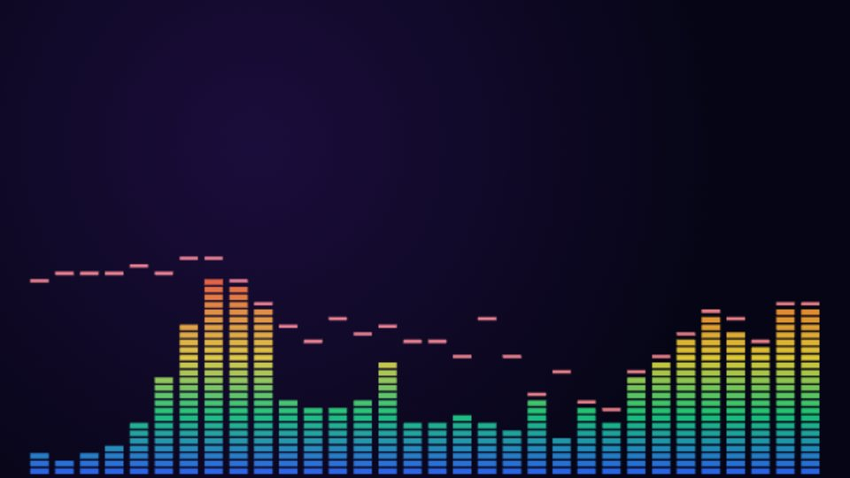
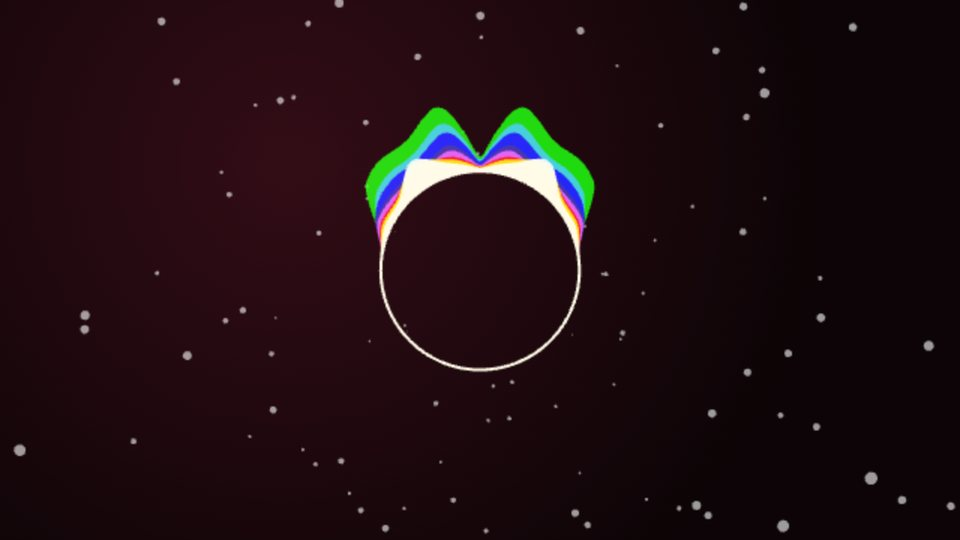
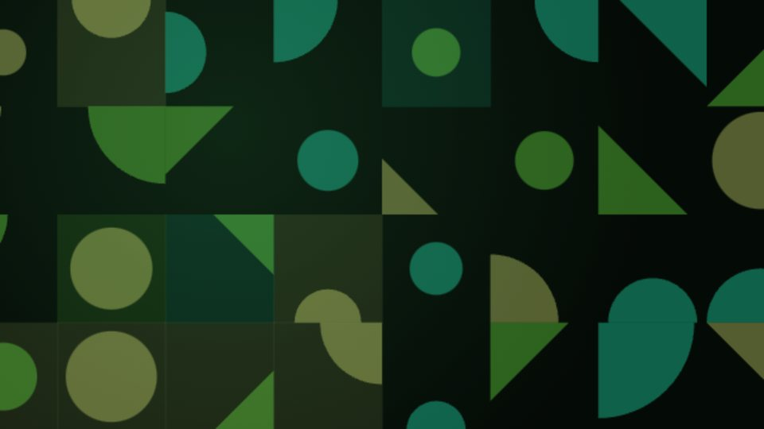
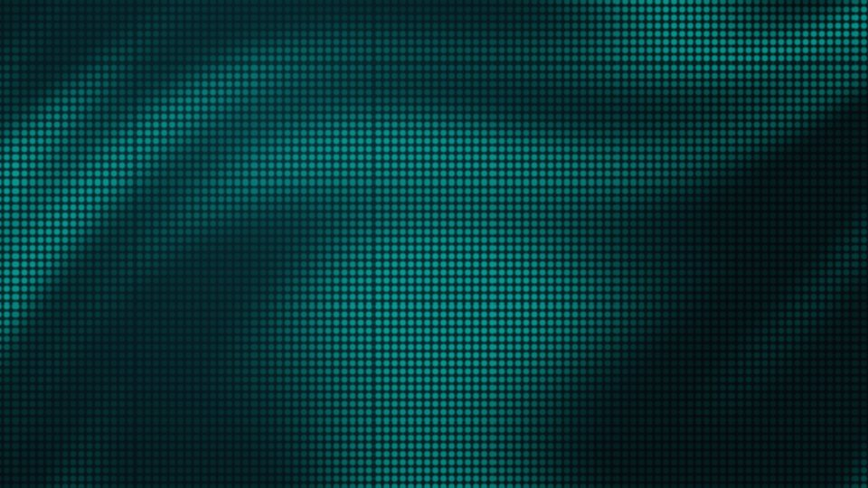
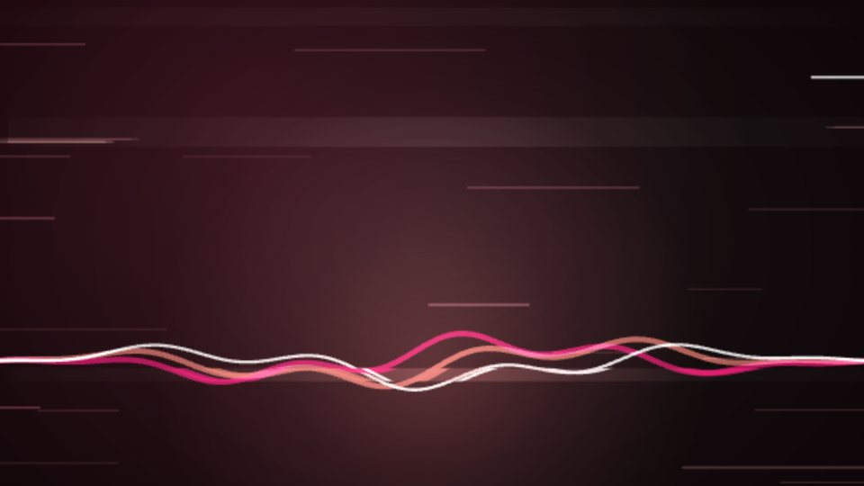

# The styles

A quick tour of every Spicy Visualiser style: what you're looking at, what it reacts to, and the settings worth trying.

Open the visualiser panel with the bars button at the top right of Spicy Lyrics. The **Style** tab picks the style. Most settings live in **Look**, and **Sound** holds the beat options.

Every style:
- sits behind the lyrics, which stay on top and readable;
- takes its colours from the album cover;
- gets a little fuller on songs with no lyrics, or with static lyrics that don't move.

On songs with no lyrics, the song name and artist take the place of Spicy Lyrics' "No lyrics" box (click it to see the box again; you can turn it off in the panel's settings).

> The screenshots were taken in Spotify with Spicy Lyrics, all on the same song, so the only thing that changes between them is the style. The colours come from the album cover.
---

## Bars

### Monstercat

The spectrum as a row of bars, with bass on the left and treble on the right. Bars snap up on a hit and fall back with a bit of gravity. A few particles drift behind them.

- **Bar colour** (Look):
  - **Flow** (default): the album colours as a slowly drifting gradient across the bars, gliding to new colours on the beat.
  - **Freq.**: bass colour on the left, treble colour on the right.
  - **Area**: colour by height on screen, so tall peaks reach a different colour (below).
  - **Bar**: each bar is one colour, picked by how tall it is.
  - **Solid**: one colour for all the bars.
- **Change every**: how many beats between colour shifts (1, 2, 4 or 8).

### Mirror Bars

Bars reflected up and down from a centre line, with the bass in the middle. Thin and calm, so it suits busy lyric pages.

### Radial Bars

The spectrum as bars round a ring, which turns a notch on every beat. It sits around the album art when the art is on screen.

### Retro Bars

The old media-player look: segmented bars coloured by height, from blue and green at the bottom to orange and red at the top. Peak caps hang for a moment, then drop. Its colours step on the beat (**Change every**).

### ASCII

A terminal-style spectrum made of characters, with falling peak markers.

### LED Wall

A panel of LED dots. Unlit dots stay faintly visible, so it reads like real hardware. Spectrum bars light up, with falling peak dots.

---

## Circles

### NCS Sphere
A slowly turning ball of glowing dots:
- a flowing pattern pushes the dots outwards, more the louder it is, so it swells and bulges with the music and stays a calm sphere in quiet parts;
- it only moves when there's sound, and kicks give it a quick pulse;
- **Circle at** can put it round the album art.

### Trap Circle

The classic trap-channel circle, empty in the middle. The spectrum is mirrored round a ring, bass at the top, exaggerated like the trap channels; the rest barely moves, so it sits still when there's no bass. A white layer sits in front, and seven colour layers burst out behind it on every hit. The circle bounces with the bass, and white dust flies towards you. Set **Circle at** to the art and it wraps the album cover instead.

### Subwoofer

A speaker drawn in light:
- kicks punch the cone out and it springs back;
- the surround wobbles with the bass;
- the light ring fades to a new colour on the beat.

---

## On the beat

These styles follow the song's beat more than the raw spectrum, so they keep a steady rhythm.

### Geometric

Bold, flat slanted bands like a modern poster, one per slice of the spectrum, sliding in from the edges. Colours step on the beat. The **Brutalist** variant adds a heavy grid and cut-out labels.

### Bauhaus Tiles

A poster grid of flat circles, half circles, quarter circles and triangles.
- Shapes grow with their part of the spectrum.
- Tiles turn a quarter on the beat and the colours step round.

---

## Flowing

### Particles

A field of light that drifts in a gentle flow and links up into constellations. It bursts outwards on kicks and twinkles with the hi-hats.

### Plasma

A smooth glowing fluid. It flows faster, swirls harder and glows brighter as the music builds, surges on kicks, and its colours sweep round on the beat. The quietest style, good when you mainly want the lyrics.

### Liquid Chrome
A sheet of glossy black liquid metal:
- mostly dark, so the lyrics stay easy to read, with thin highlights in the album's colours sliding over its curves;
- it rolls slowly and the bass swells the waves; no beat effects, it just flows.

### Oil Slick
Rainbow swirls like oil on a wet road at night:
- it just flows; the bass stirs the swirls harder and moves the colours;
- the colours shift slowly round on the beat;
- **Colours: Classic** (default) is the oil rainbow; the other colour modes tint it.

### LED Plasma

The same fluid as Plasma, shown on the LED dot panel.

### Warp

Hyperspace stars flying past, faster on the bass, with a surge on every beat.

### Liquid

A flowing three-strand bass wave that pumps on kicks, with speed streaks racing past and a flash on every snare. Made with drum & bass in mind.

### Neuro Mesh

A wireframe landscape rolling towards you, shaped by the spectrum. It glitches on snares.

Settings to try:
- **Twist** (slider): makes it wobble with the bass like a reese.
- **Mirror**: reflects the landscape.
- **Look**:
  - Mesh (above);
  - Lines: stacked wave lines;
  - Ridges: flat stacked lines like the classic pulsar-plot album cover (below).
- **Ridges line**: rough or smooth.

---

## Calm

Slow, soft styles for chill songs. They all work well without the helper.

### Aurora
Northern lights over a starry sky:
- three curtains of light in the album's colours ripple sideways, with fine rays running up them;
- the bass lifts them higher and taller, loudness makes them brighter and faster, kicks make them flare.

### Ombre
Rich colour glowing in from the screen edges, fading to dark in the middle behind the lyrics:
- the colours run round the edges as a soft gradient and slowly turn;
- the bass pushes the glow further in, loudness makes it brighter, kicks give it a soft pulse.

### Galaxy
Drifting slowly through a coloured nebula, stars streaming past:
- the bass makes the gas glow brighter and swirl;
- loudness speeds up the flight, kicks make the stars flash.

### Labradorite
A dark, slightly mossy stone surface with little flecks of rainbow shimmer scattered over it, thicker towards the middle:
- the flecks drift and shimmer slowly; louder parts and the bass bring out more of them, kicks make them flare;
- **Colours: Classic** (default) is the rainbow shimmer; the other colour modes tint it.

### Bubbles
Soap bubbles floating up, each a clear film with a thin rainbow rim and a bright window reflection:
- the bass sends more up, and faster; kicks pop a few;
- **Colours: Classic** (default) is the soap-film rainbow; the other colour modes tint the rims;
- **Particles** sets how many.

### Ribbon
Soft sheets of light rolling across the screen, like the wave on an old games-console home menu:
- no drawn lines: each sheet is soft at its edges and brighter where it folds over, and runs right across the screen;
- the music sets how fast they flow and the bass makes the waves bigger; each kick makes them flash brighter and turns their colours a little further round;
- a few sparkles drift along with them.

### Rain on Glass
Looking out of a rainy window at night:
- big, soft out-of-focus lights in the album's colours glow behind the glass;
- drops keep landing (the bass sets how hard it rains, kicks bring a burst); drops that touch join up, and heavy ones run down, picking up the drops in their way;
- they leave a faint wet smear that breaks into little beads and dries up within a few seconds, and drops left sitting slowly evaporate.

### Lava Lamp
Lumpy blobs of colour rising and sinking, stretching, merging and splitting:
- louder parts make them move faster;
- the bass swells them and kicks give them a wobble;
- the colours step round on the beat.

### Smoke
Soft coloured smoke curling up from the bottom:
- louder parts make it thicker and rise faster;
- the bass stirs it into curls, and kicks puff out a burst from below;
- the colours turn on the beat.

---

## Into the light

### Starfield Tunnel
Flying down a gently bending tunnel of glowing rings, with stars streaming past:
- the bass widens the rings and speeds you up;
- kicks make the nearest rings flash;
- the colours step round on the beat.

---

## If the beat feels off

**Auto-tune beats** (Sound tab, on by default) learns each song's kick level in its first few seconds, so busy bass doesn't fire on every note and quiet songs still catch their kicks. Beat sensitivity still works on top of it.

Open the **Sound** tab:
- **Tap to the beat**: tap the button along with the song 4 or more times, and everything locks to your tempo for that song.
- **Beat sensitivity**: lower it if it's catching beats that aren't there, raise it if it misses soft kicks.
- The panel also shows where the beat is coming from: your taps, the song's own beat data, or the kicks it hears.
