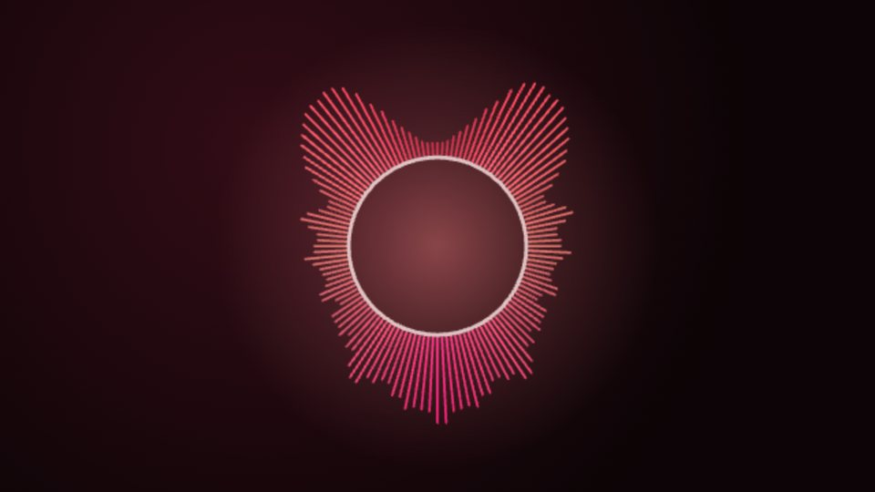
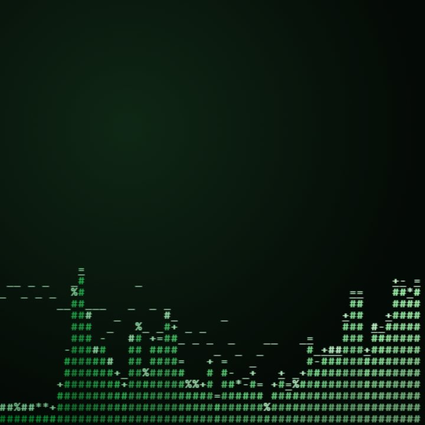
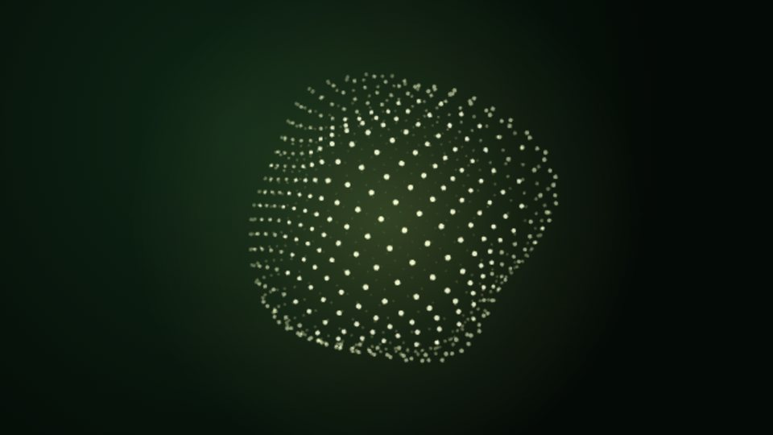
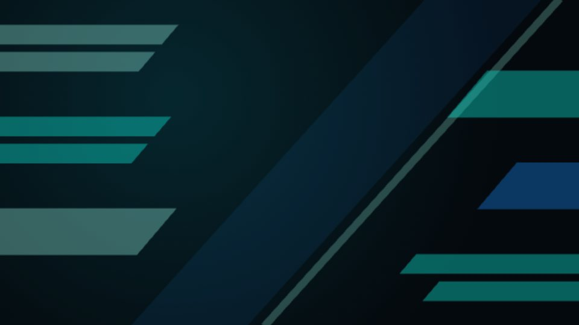
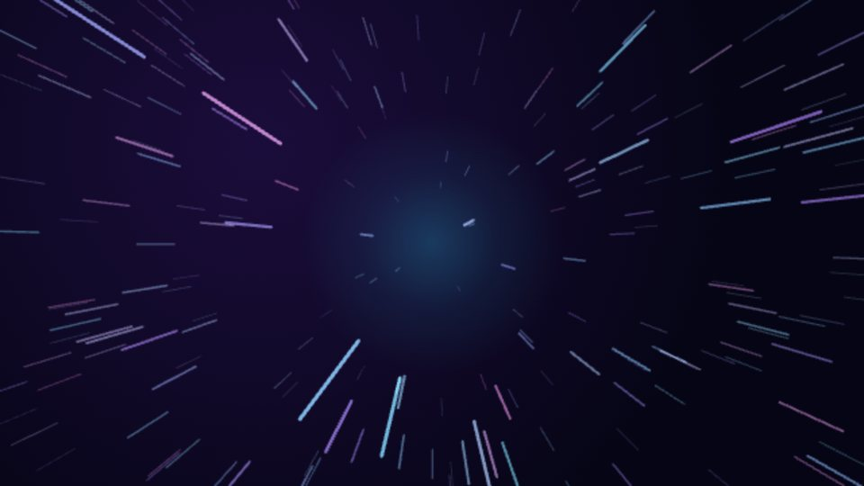
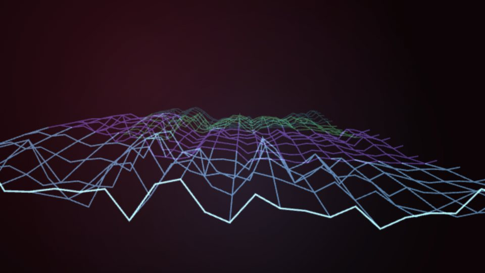

# The styles

A quick tour of every Spicy Visualiser style: what you're looking at, what it reacts to, and the settings worth trying.

Open the visualiser panel with the bars button at the top right of Spicy Lyrics. The **Style** tab picks the style. Most settings live in **Look**, and **Sound** holds the beat options.

Every style:
- sits behind the lyrics, which stay on top and readable;
- takes its colours from the album cover;
- gets a little fuller on songs with no lyrics, or with static lyrics that don't move.

> The screenshots were taken in Spotify with Spicy Lyrics, all on the same song, so the only thing that changes between them is the style. The colours come from the album cover.
---

## Bars

### Monstercat

The spectrum as a row of bars, with bass on the left and treble on the right. Bars snap up on a hit and fall back with a bit of gravity. A few particles drift behind them.

- **Bar colour** (Look):
  - **Flow** (default): the album colours as a slowly drifting gradient across the bars, gliding to new colours on the beat.
  - **Freq.**: bass colour on the left, treble colour on the right.
  - **Area**: colour by height on screen, so tall peaks reach a different colour (below).
  - **Bar**: each bar is one colour, picked by how tall it is.
  - **Solid**: one colour for all the bars.
- **Change every**: how many beats between colour shifts (1, 2, 4 or 8).

### Mirror Bars

Bars reflected up and down from a centre line, with the bass in the middle. Thin and calm, so it suits busy lyric pages.

### Radial Bars

The spectrum as bars round a ring, which turns a notch on every beat. It sits around the album art when the art is on screen.

### Retro Bars

The old media-player look: segmented bars coloured by height, from blue and green at the bottom to orange and red at the top. Peak caps hang for a moment, then drop. Its colours step on the beat (**Change every**).

### ASCII

A terminal-style spectrum made of characters, with falling peak markers.

### LED Wall

A panel of LED dots. Unlit dots stay faintly visible, so it reads like real hardware. Spectrum bars light up, with falling peak dots.

---

## Circles

### NCS Sphere

A sphere of glowing dots. It flows with the loudness, bulges by frequency (bass at the top) and gets nudged by kicks.

### Trap Circle

The classic trap-channel circle, empty in the middle. The spectrum is mirrored round a ring, bass at the top and treble at the bottom. Every part of the spectrum makes its own peaks, so the shape changes with the song. A white layer sits in front, and seven colour layers burst out behind it on every hit. The circle bounces with the bass, and white dust flies towards you. Set **Circle at** to the art and it wraps the album cover instead.

### Subwoofer

A speaker drawn in light:
- kicks punch the cone out and it springs back;
- the surround wobbles with the bass;
- the light ring changes colour on the beat.

---

## On the beat

These styles follow the song's beat more than the raw spectrum, so they keep a steady rhythm.

### Geometric

Bold, flat slanted bands like a modern poster, one per slice of the spectrum, sliding in from the edges. Colours step on the beat. The **Brutalist** variant adds a heavy grid and cut-out labels.

### Bauhaus Tiles

A poster grid of flat circles, half circles, quarter circles and triangles.
- Shapes grow with their part of the spectrum.
- Tiles turn a quarter on the beat and the colours step round.

---

## Flowing

### Particles

A field of light that drifts in a gentle flow and links up into constellations. It bursts outwards on kicks and twinkles with the hi-hats.

### Plasma

A smooth glowing fluid. It flows faster, swirls harder and glows brighter as the music builds, surges on kicks, and its colours sweep round on the beat. The quietest style, good when you mainly want the lyrics.

### LED Plasma

The same fluid as Plasma, shown on the LED dot panel.

### Silk
Long streaks of colour pulled through a slow current, like ink drawn through water:
- the bass speeds the current up;
- kicks bloom a burst of new streaks from one spot;
- snares flick a few thin, bright ones;
- the colours step round on the beat.

The **Smoothing** slider sets how long the streaks last.

### Warp

Hyperspace stars flying past, faster on the bass, with a surge on every beat.

### Liquid

A flowing three-strand bass wave that pumps on kicks, with speed streaks racing past and a flash on every snare. Made with drum & bass in mind.

### Neuro Mesh

A wireframe landscape rolling towards you, shaped by the spectrum. It glitches on snares.

Settings to try:
- **Twist** (slider): makes it wobble with the bass like a reese.
- **Mirror**: reflects the landscape.
- **Look**:
  - Mesh (above);
  - Lines: stacked wave lines;
  - Ridges: flat stacked lines like the classic pulsar-plot album cover (below).
- **Ridges line**: rough or smooth.

---

## Calm

Slow, soft styles for chill songs. They all work well without the helper.

### Ribbon
Calm wave sheets made of fine lines, twisting like silk ribbons as they drift across the screen, with tiny sparkles floating up:
- the bass swells the waves a little;
- louder parts speed them up;
- kicks make them glow;
- the tint comes from the album.

### Rain on Glass
Looking out of a rainy window at night:
- blurred city lights in the album's colours glow behind the glass, brighter with the bass;
- small drops land all the time, more when it's loud;
- big drops run down, picking up the small ones and leaving a trail;
- kicks shake a few drops loose.

### Fireflies
Soft points of light drifting in the dark:
- each one glows on its own;
- on every beat a wave of light runs across them, so they flash together;
- snares make a few twinkle;
- **Particles** sets how many there are.

### Lava Lamp
Big soft blobs of colour rising and sinking, merging and splitting:
- louder parts make them move faster;
- the bass swells them and kicks give them a wobble;
- the colours step round on the beat.

---

## If the beat feels off

Open the **Sound** tab:
- **Tap to the beat**: tap the button along with the song 4 or more times, and everything locks to your tempo for that song.
- **Beat sensitivity**: lower it if it's catching beats that aren't there, raise it if it misses soft kicks.
- The panel also shows where the beat is coming from: your taps, the song's own beat data, or the kicks it hears.
