# The styles

A quick tour of every Spicy Visualiser style: what you're looking at, what it reacts to, and the settings worth trying.

Open the visualiser panel with the bars button at the top right of Spicy Lyrics. The **Style** tab picks the style. Most settings live in **Look**. **Sound** holds how it reacts and the beat options, including **Fit each song** (on by default), which learns each song's levels as it plays so quiet and loud songs both move well.

Every style:
- sits behind the lyrics, which stay on top and readable;
- takes its colours from the album cover;
- gets a little fuller on songs with no lyrics, or with static lyrics that don't move.

On songs with no lyrics, the song name and artist take the place of Spicy Lyrics' "No lyrics" box, except in fullscreen, where Spicy's box is left alone (click it to see the box again; you can turn it off in the panel's settings).

> The pictures show just the visualiser (no lyrics), all playing the same test song. The colours come from the album cover, so they change between a few made-up albums.
---

## Bars & meters

### Monstercat
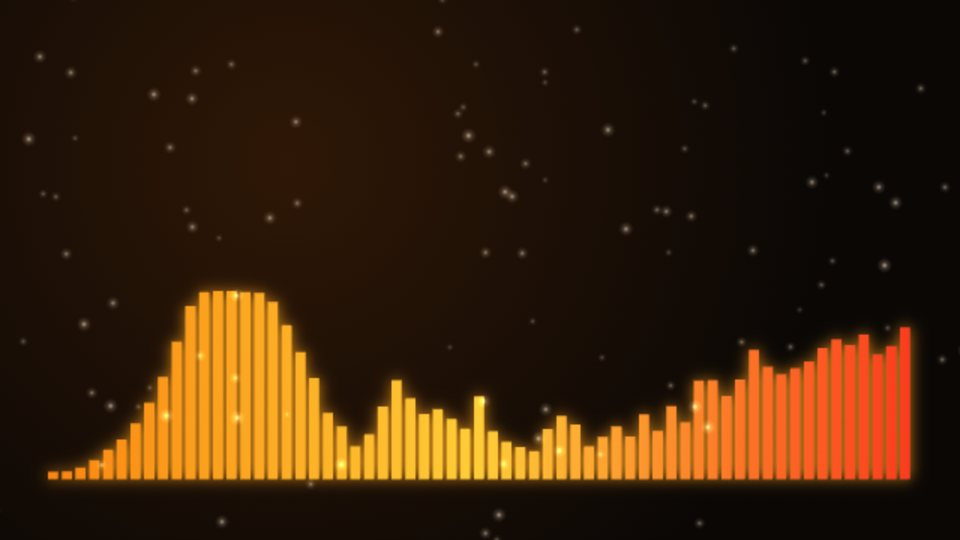

The spectrum as a row of bars, with bass on the left and treble on the right. Bars snap up on a hit and fall back with a bit of gravity. A few particles drift behind them.

- **Bar colour** (Look):
  - **Flow** (default): the album colours as a slowly drifting gradient across the bars, gliding to new colours on the beat.
  - **Freq.**: bass colour on the left, treble colour on the right.
  - **Area**: colour by height on screen, so tall peaks reach a different colour (below).
  - **Bar**: each bar is one colour, picked by how tall it is.
  - **Solid**: one colour for all the bars.
- **Change every**: how many beats between colour shifts (1, 2, 4 or 8).

### Mirror Bars
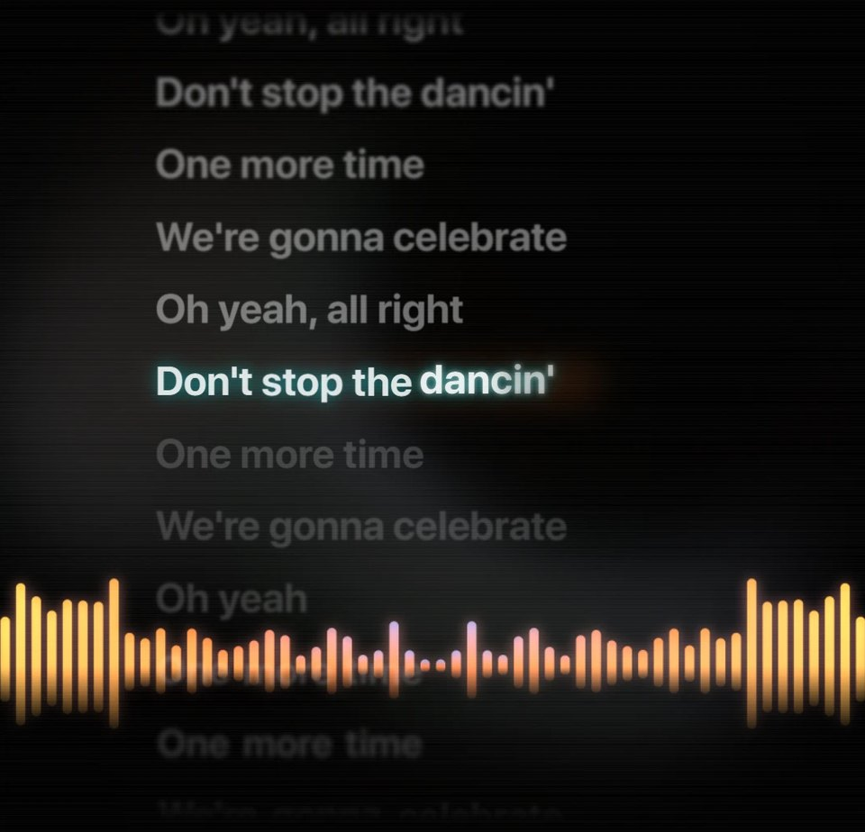

Bars reflected up and down from a centre line, with the bass in the middle. Thin and calm, so it suits busy lyric pages.

### LED Meters
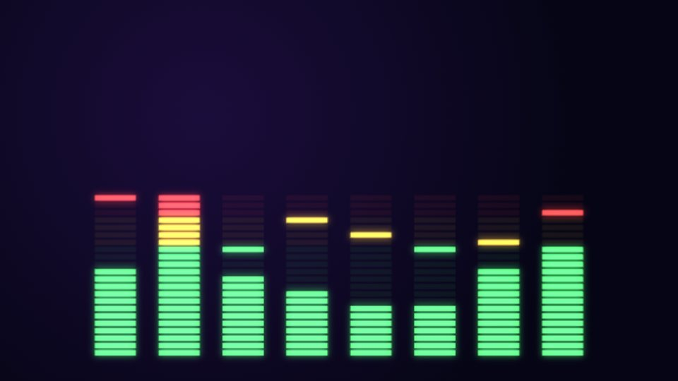

Studio LED ladders along the bottom, one per part of the spectrum: green, then yellow, then red at the top, each lit segment glowing. A peak light hangs for a moment, then drops.

### LED Wall
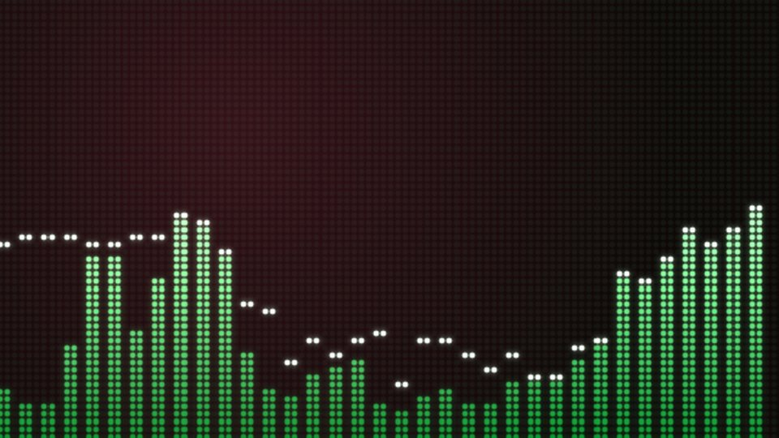

A panel of LED dots. Unlit dots stay faintly visible, so it reads like real hardware. Spectrum bars light up, with falling peak dots.

### ASCII

A terminal-style spectrum made of characters, with falling peak markers.

### VU Meters
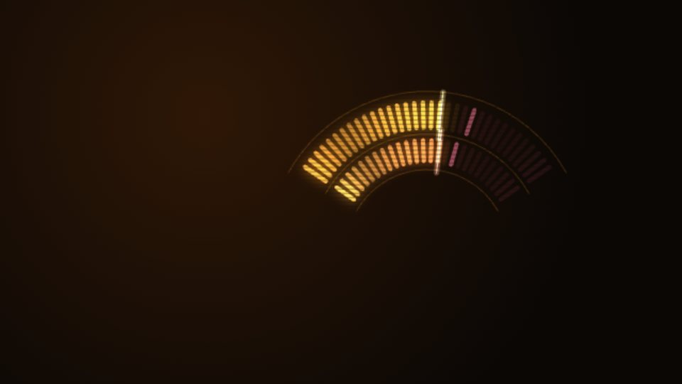

One meter with two needles, like a stereo meter: one for the bass (low), one for the mids and highs (high). It sits in the middle, or beside the album art when the art is showing. The needles are a little sluggish and swing past before settling (**Smoothing** sets how sluggish), and a peak light comes on when a needle goes into the red. Five looks (**Look**):
- **Classic** (above): night hi-fi, a face glowing warm amber from behind in a dark room, the print and needles as dark silhouettes (black is low, red is high);
- **Minimal**: no box, just a thin scale in the album's colours, a red zone that glows (brighter when a needle's in it) and two thin needles in the album's colours;
- **Broadcast**: an old radio-studio meter, matte black face, white print marked 1 to 7, with a red needle and a green one;
- **Holo**: two floating arcs of ticks (outer low, inner high) that light up to their needles, with a glowing needle line and a faint scanline shimmer. Its needle is heavier and only really moves on bigger changes;
- **HUD**: a sci-fi gauge, two segmented level arcs inside a slowly turning ring.

### Oscilloscope
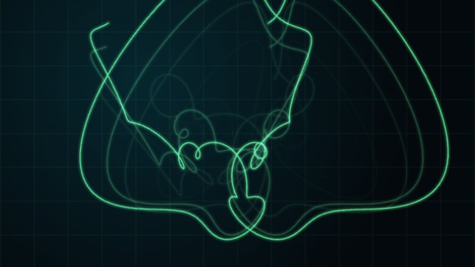

A glowing line tracing the sound like an old scope, over a faint grid:
- quiet parts are a calm wave; as the music gets busy the trace curls round into looping figure shapes;
- the line glows on for a moment after it passes, like a real scope screen;
- **Colours: Classic** (default) is green phosphor; the other colour modes use those colours.

### Chip Scope
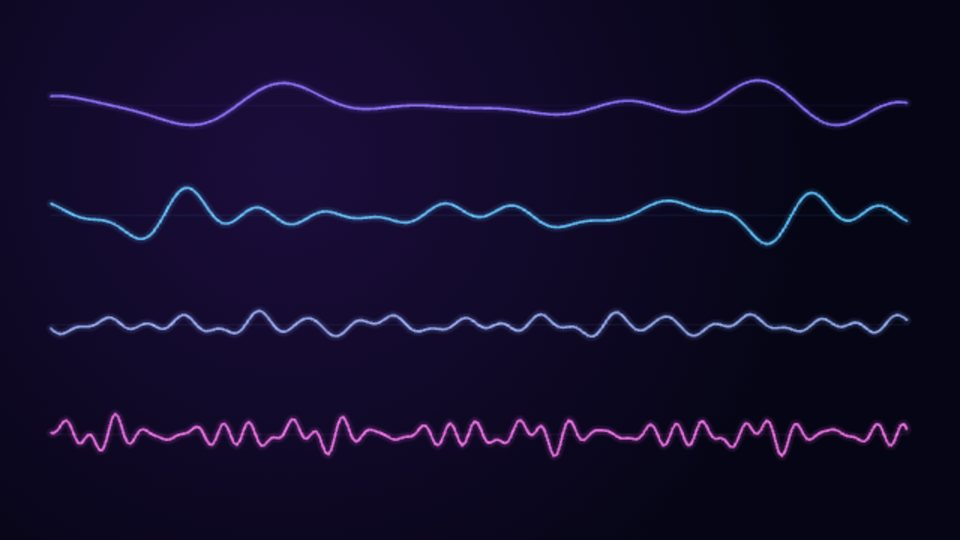

Four channels of wave readings, like the scope view in a chiptune tracker: the bass as a square wave, low mids as a thin pulse, high mids as a triangle and the highs as noise. Each moves with its part of the sound: louder makes it taller, and higher notes in that part pack the waves closer together.

---

## Holo & EKG

Glowing lines and ticks in the album's colours. Holo Spectrum has the look of the VU Meters' Holo face: ticks that glow when lit and stay faintly visible when not, a slow shimmer and drifting scanlines. The EKG styles are glowing lines like a heart monitor. **Speed** sets how fast the EKG lines sweep.

### Holo Spectrum
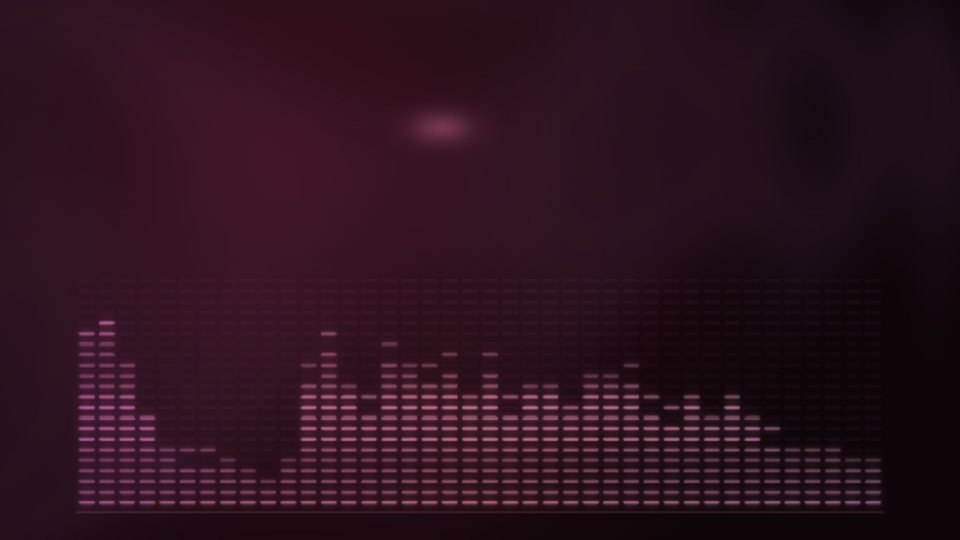

Monstercat-style bars (bass on the left, neighbours smoothed into hills), each a stack of short glowing ticks, with a peak tick that hangs over each bar. **Bar count** sets how many.

### EKG
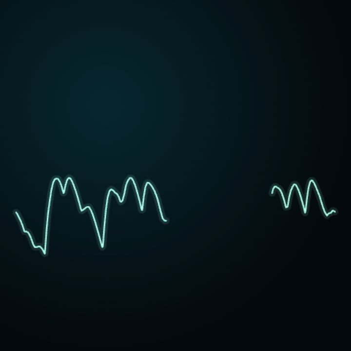

Like a heart monitor: the line writes across from left to right and wipes just ahead of itself. It stays flat between hits; each kick makes a heartbeat shape and each snare a short sharp blip.

### EKG Pitch
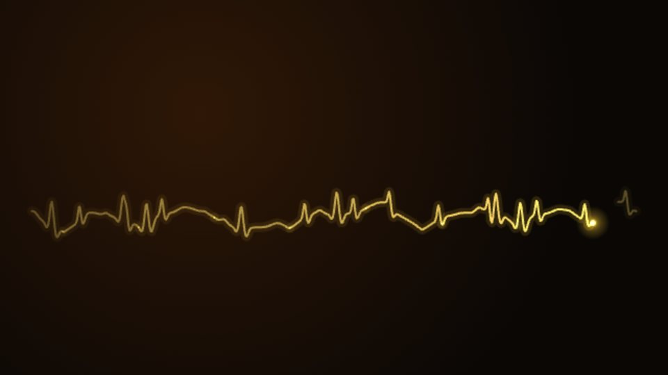

The same sweep, but the line also rises and falls with where the sound sits in pitch. It's the rough pitch (about two piano keys a step), not exact notes.

### EKG Scroll
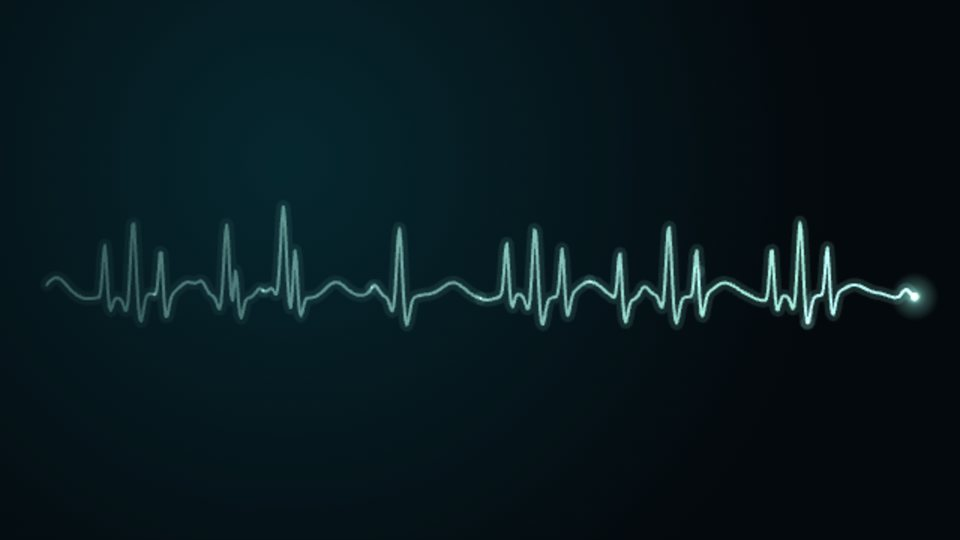

The heartbeat line scrolling left from the right edge, instead of sweeping across.

### EKG x3
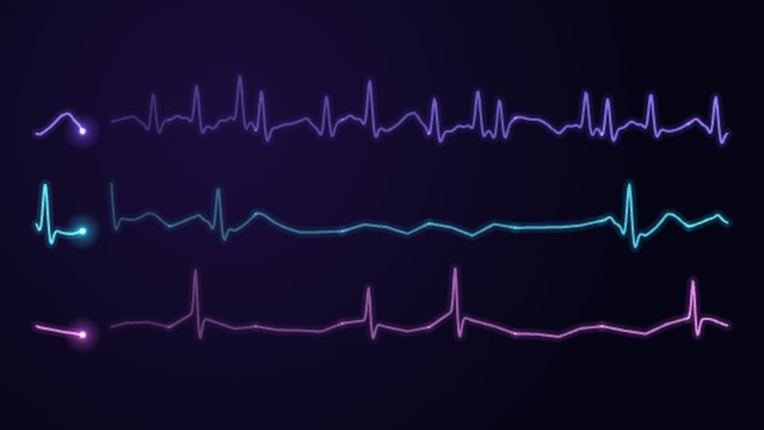

Three sweeping lines, each spiking on its own hits: the bass and drums, the middle of the sound (where voices mostly sit), and the high sounds.

---

## Circles

### Radial Bars

The spectrum as bars round a ring, which turns a notch on every beat. It sits around the album art when the art is on screen.

### Sphere

A slowly turning ball of glowing dots:
- a flowing pattern pushes the dots outwards, more the louder it is, so it swells and bulges with the music and stays a calm sphere in quiet parts;
- it only moves when there's sound, and kicks give it a quick pulse;
- **Circle at** can put it round the album art.

### Subwoofer
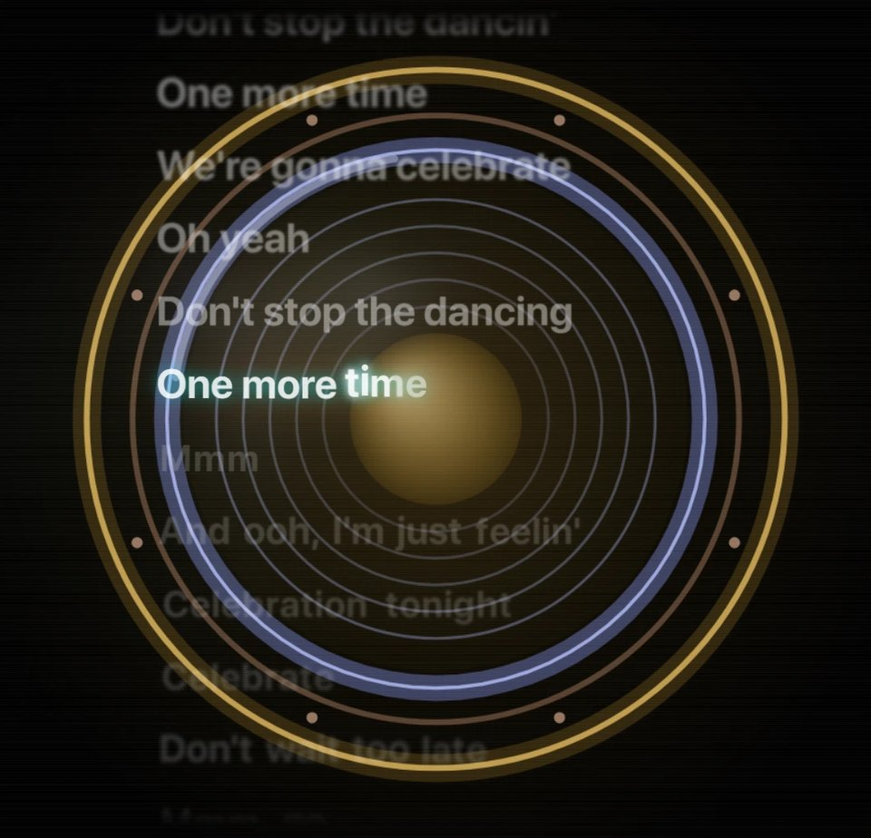

A speaker drawn in light:
- kicks punch the cone out and it springs back;
- the surround wobbles with the bass;
- the light ring fades to a new colour on the beat.

### Trap

The classic trap-channel circle, empty in the middle. The spectrum is mirrored round a ring, bass at the top, exaggerated like the trap channels; the rest barely moves, so it sits still when there's no bass. A white layer sits in front, and seven colour layers burst out behind it on every hit. The circle bounces with the bass, and white dust flies towards you. Set **Circle at** to the art and it wraps the album cover instead.

### Starfield Tunnel
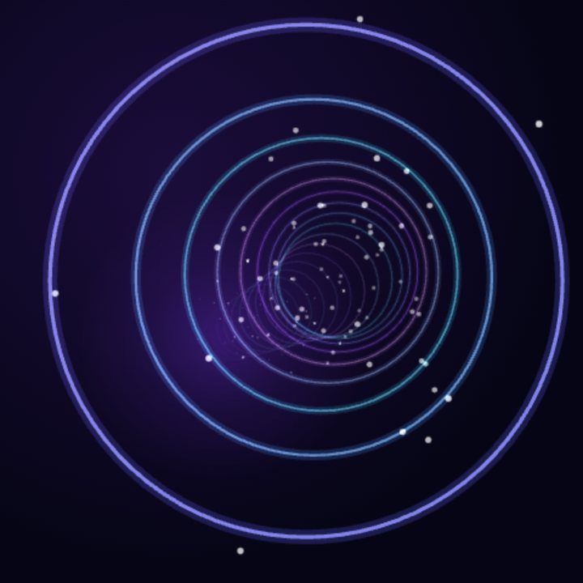

Flying down a gently bending tunnel of glowing rings, with stars streaming past:
- the bass widens the rings and speeds you up;
- kicks make the nearest rings flash;
- the colours step round on the beat.

---

## On the beat

These styles follow the song's beat more than the raw spectrum, so they keep a steady rhythm.

Two drum styles show only the drum hits, nothing else, in the album's colours. They spring up on each hit and swing a little past before settling, like a VU needle (**Smoothing** sets how loose), and with **Fit each song** on they learn each song's drum levels, so quiet and loud songs both hit hard.

### Drum Pads
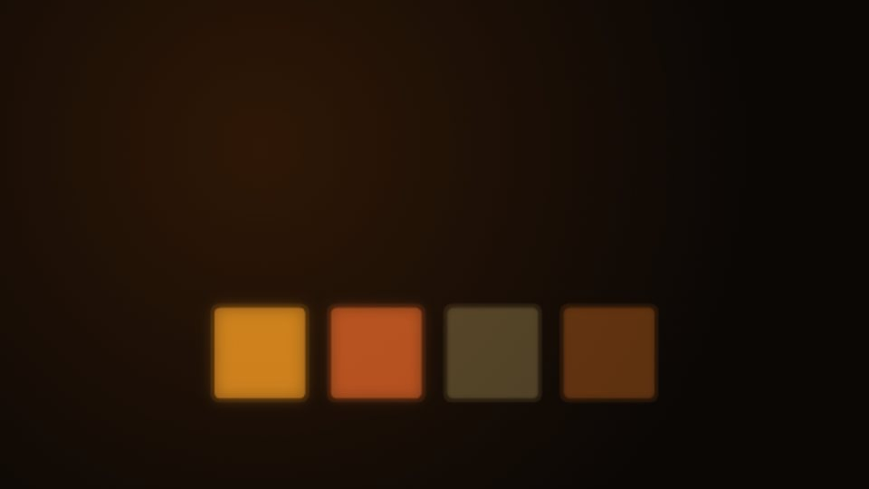

Four drum-machine pads (kick, snare, hi-hat, bass) that light up as each is hit, then fade.

### Impact
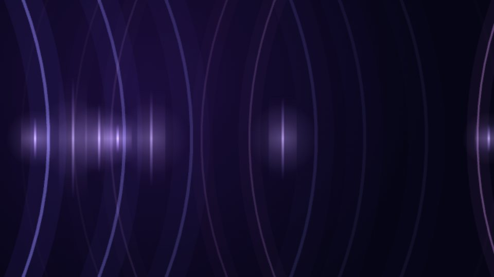

Each kick sends a wave in from the left, each snare one in from the right. Where two meet they burst into a flash that spreads up and down. Harder hits make brighter waves.

### Geometric

Bold, flat slanted bands like a modern poster, one per slice of the spectrum, sliding in from the edges. Colours step on the beat. The **Brutalist** variant adds a heavy grid and cut-out labels.

### Bauhaus

A poster grid of flat circles, half circles, quarter circles and triangles.
- Shapes grow with their part of the spectrum.
- Tiles turn a quarter on the beat and the colours step round.

---

## Liquid colour

### Plasma
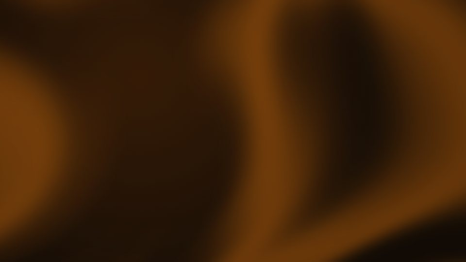

A smooth glowing fluid. It flows faster, swirls harder and glows brighter as the music builds, surges on kicks, and its colours sweep round on the beat. The quietest style, good when you mainly want the lyrics.

### LED Plasma

The same fluid as Plasma, shown on the LED dot panel.

### Oil Slick
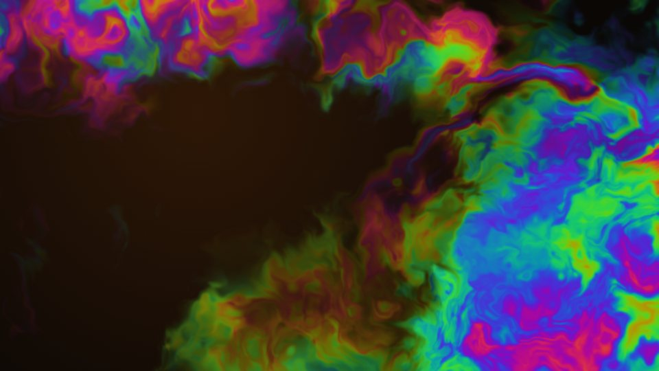

Patches of rainbow swirls like oil on a wet road at night, with plenty of dark road between them:
- it just flows; the bass stirs the swirls harder and moves the colours;
- the colours shift slowly round on the beat;
- **Colours: Classic** (default) is the oil rainbow; the other colour modes tint it.

### Mercury
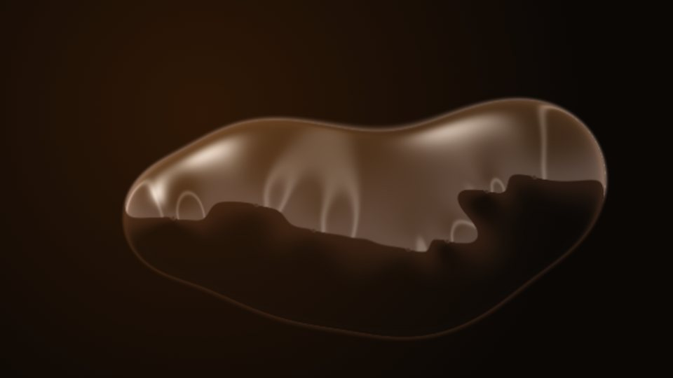

Blobs of liquid metal that drift, merge and split apart. The bass swells them and pushes them apart; they mirror a bright sky over a sharp horizon in the album's colours, and kicks flash the highlights.

### Liquid

A flowing three-strand bass wave that pumps on kicks, with speed streaks racing past and a flash on every snare. Made with drum & bass in mind.

---

## Water

### Ocean
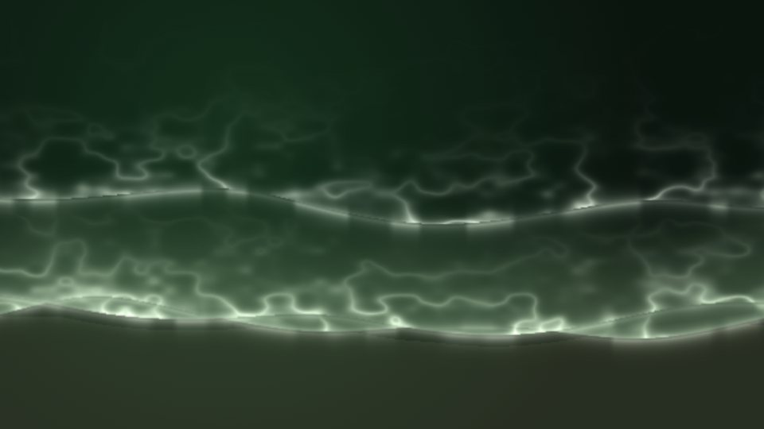

Seen from the side: layers of waves rolling across the bottom, the far ones small and dim, the near ones big. The bass raises the swell and kicks brighten the foam along the crests.

### Underwater
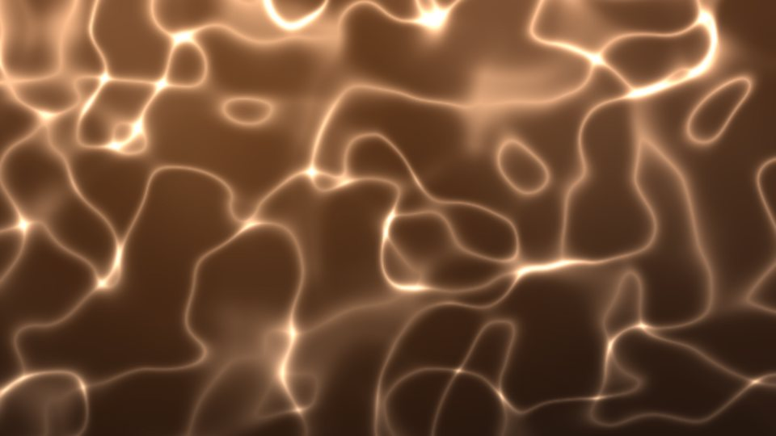

Looking up from under the sea: rippling nets of light wobble across, with soft shafts of light from the surface. The bass makes the light wobble harder; loudness and kicks brighten it.

### Pond

Looking down at still dark water that reflects a soft sky. Each kick drops a ring of ripples that spreads out and crosses the others.

---

## Sky & light

### Aurora
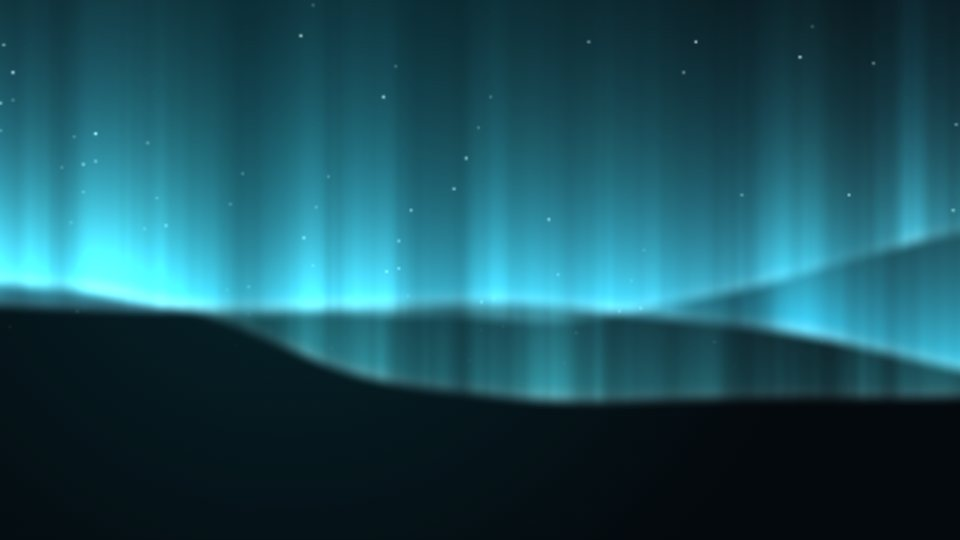

Northern lights over a starry sky:
- three curtains of light in the album's colours ripple sideways, with fine rays running up them;
- the bass lifts them higher and taller, loudness makes them brighter and faster, kicks make them flare.

### Galaxy
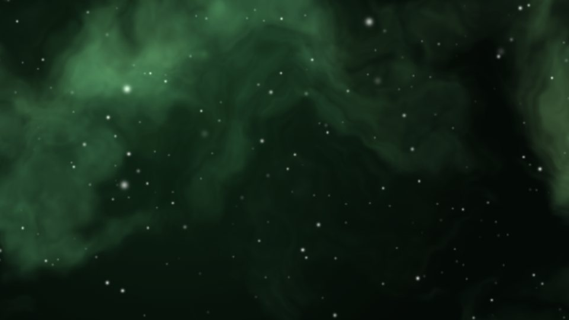

Drifting slowly through a coloured nebula, stars streaming past. One slow, smooth drive from the loudness and bass sets how fast it flies and how brightly the gas glows, easing up and down over a couple of seconds, so it never lurches on a hit or stalls in a quiet bit.

### Sunset
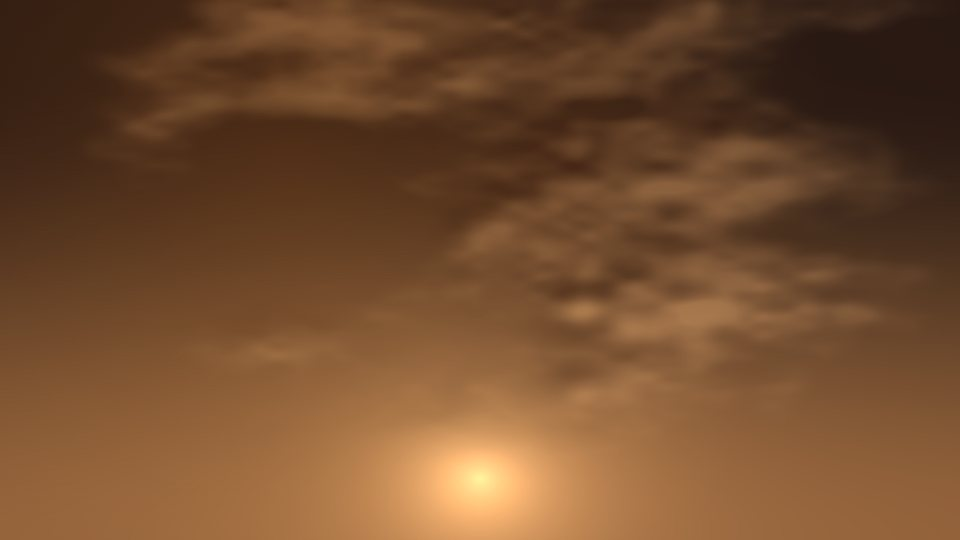

A sky in the album's colours, warm at the horizon with the sun low in the middle. Soft clouds drift across, lit from below; they glow a little on the beat and drift faster when it's busy.

### Storm
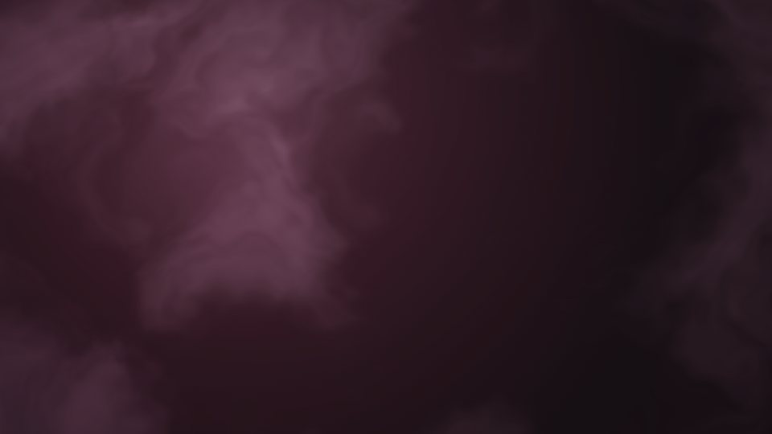

Dark clouds rolling and churning, harder on the bass. Lightning lights them from inside on kicks and snares, and now and then a forked bolt cracks down on the biggest hits.

### Night Sky
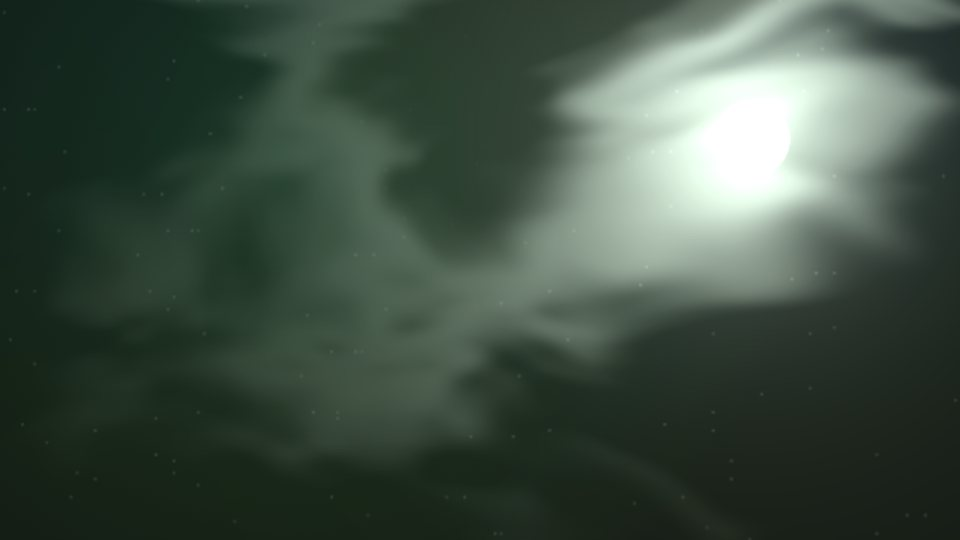

A dark sky with twinkling stars and a moon, and thin clouds drifting past it, silver at the edges near the moon. It slowly brightens as the music gets fuller.

### Ribbon
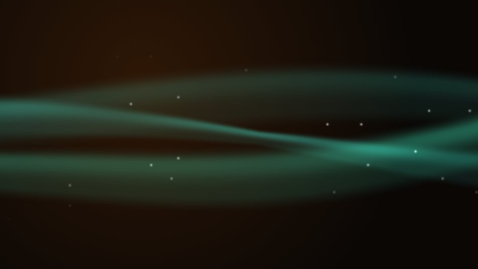

Soft sheets of light rolling across the screen, like the wave on an old games-console home menu:
- no drawn lines: each sheet is soft at its edges and brighter where it folds over, and runs right across the screen;
- the music sets how fast they flow and the bass makes the waves bigger; each kick makes them flash brighter and turns their colours a little further round;
- a few sparkles drift along with them.

### Ombre

Rich colour glowing in from the left and right sides, with the middle left dark behind the lyrics:
- the colours run down each side as a soft gradient and slowly turn;
- the bass drives it: it pushes the glow further in and makes it brighter, and kicks give it a soft pulse.

### Warp

Hyperspace stars flying past, faster on the bass, with a surge on every beat.

### Particles

A field of light that drifts in a gentle flow and links up into constellations. It bursts outwards on kicks and twinkles with the hi-hats.

---

## Textures

### Graphite
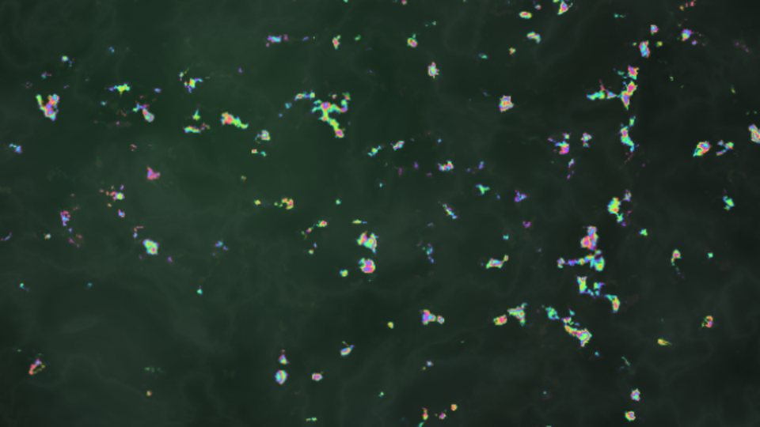

A dark, slightly mossy stone surface with little flecks of rainbow shimmer scattered over it, thicker towards the middle:
- the stone slowly drifts and warps, and a slow wave of light travels over it, bringing flecks out in new places while others fade back; the rainbow keeps sliding through them; louder parts and the bass bring out more of them, kicks make them flare;
- **Colours: Classic** (default) is the rainbow shimmer; the other colour modes tint it.

### Rain on Glass
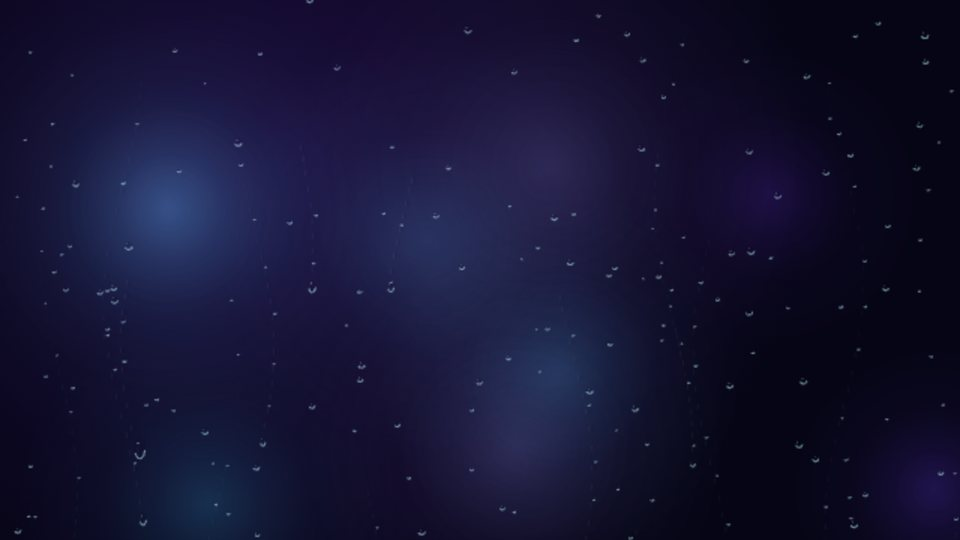

Looking out of a rainy window at night:
- big, soft out-of-focus lights in the album's colours glow behind the glass;
- drops keep landing (the bass sets how hard it rains, kicks bring a burst); drops that touch join up, and heavy ones run down, picking up the drops in their way;
- they leave a faint wet smear that breaks into little beads and dries up within a few seconds, and drops left sitting slowly evaporate.

### Smoke
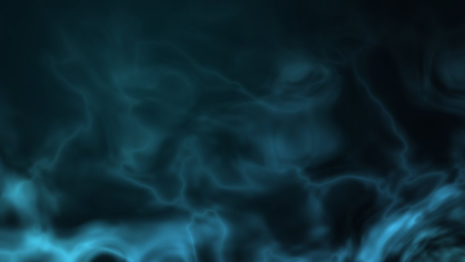

Soft coloured smoke curling up from the bottom:
- louder parts make it thicker and rise faster;
- the bass stirs it into curls, and kicks puff out a burst from below;
- the colours turn on the beat.

### Lava Lamp
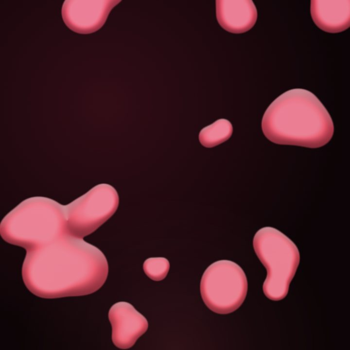

Lumpy blobs of colour rising and sinking, stretching, merging and splitting:
- louder parts make them move faster;
- the bass swells them and kicks give them a wobble;
- the colours step round on the beat.

### Neuro Mesh

A wireframe landscape rolling towards you, shaped by the spectrum. It glitches on snares.

Three looks (**Look**):
- Mesh (above);
- Lines: stacked wave lines;
- Ridges: flat stacked lines like the classic pulsar-plot album cover (below).

---

## If the beat feels off

**Fit each song** (Sound tab, on by default) learns each song's kick level in its first few seconds, so busy bass doesn't fire on every note and quiet songs still catch their kicks. Beat sensitivity still works on top of it.

Open the **Sound** tab, then **Fine-tune**:
- **Tap to the beat**: tap the button along with the song 4 or more times, and everything locks to your tempo for that song.
- **Beat sensitivity**: lower it if it's catching beats that aren't there, raise it if it misses soft kicks.
- The panel also shows where the beat is coming from: your taps, the song's own beat data, or the kicks it hears.
